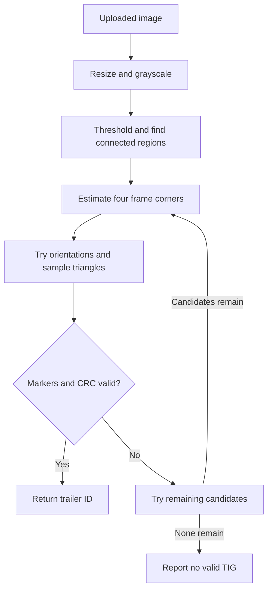

TIG is my custom visual identification format: a strip of squares split diagonally into triangles, used to encode a trailer ID. The working name stands for **Trailer Identification Grid**.

![[{11ECD2F2-9211-4480-8BB4-BCC9F050B79A}.png]]

The idea started with markings I put on the sides of trailers in an older piece of artwork. They looked like some unfamiliar industrial barcode. I wanted to give that visual design actual rules, then build something that could generate and read it. Apparently fictional space trailers need paperwork too.

This page documents **TIG 1.0 and the first TIG Studio implementation**. It is both a design explanation and a reference for reproducing the format. The original artwork is the visual prototype; its markings were not generated under these rules and should not be expected to decode.

## What a TIG plate identifies

A plate stores a **32-bit identifier**, displayed as eight hexadecimal characters. For example:

```text
7A3F029C
```

It works like a license plate. The identifier stays with the trailer; other information belongs in a separate registry.

| Stored in the plate | Stored in a future registry |
| --- | --- |
| Trailer ID | Owner or operator |
| Checksum for that ID | Manufacturer and model |
| Fixed orientation markers | Cargo, destination, maintenance, and other changing details |

TIG Studio currently generates and reads plates. It does **not** include that registry, assign ownership, or track cargo.

A 32-bit field has 4,294,967,296 possible values, including `00000000`. The current implementation does not reserve a special value. Eight hexadecimal characters are just the readable representation of those 32 bits, not eight stored text characters.

## One square, four states

Every cell is a square divided along a diagonal running from its **top-left corner to its bottom-right corner**. Each triangular half can be filled or empty.

| Numeric state | Bit pair | Filled area |
| --- | --- | --- |
| 0 | `00` | Neither triangle; empty square |
| 1 | `01` | Upper-right triangle |
| 2 | `10` | Lower-left triangle |
| 3 | `11` | Both triangles; full square |

Four states encode **two bits per cell**. In this mapping, the upper-right half contributes the low bit and the lower-left half contributes the high bit.

“Empty” means the panel background shows through. The normal generated plate uses black marks on white. The reader also tries the opposite polarity, allowing light marks on a dark background when the whole design is inverted consistently.

The diagonal is an encoding boundary, not a separate line drawn over every cell. Adjacent filled cells can merge into larger shapes. The reader uses the frame geometry to know where the invisible cell boundaries lie.

## Plate layout

The data area contains **three rows and eight columns**. That is 24 data cells:

$$24\text{ cells}\times2\text{ bits}=48\text{ bits}$$

Those 48 bits hold a 32-bit ID and a 16-bit checksum.

There is also one fixed marker column at each end, so the **complete symbol contains three rows and ten columns**, surrounded by a rectangular frame. The markers are separate from the 48-bit payload.

| Row, top to bottom | Left marker | Eight data columns | Right marker |
| --- | --- | --- | --- |
| Top | Full: `3` | Data | Empty: `0` |
| Middle | Upper-right: `1` | Data | Lower-left: `2` |
| Bottom | Empty: `0` | Data | Full: `3` |

The frame gives the reader a candidate boundary and four corners. The marker pattern lets it test which corner is the start and which way the symbol should be read.

The printed hexadecimal ID below the frame is for people. The reader does not perform text recognition and does not depend on that caption. The small `TIG / 1.0` caption is also a human-readable label.

## Reading order and bit packing

Read the data **down each column, then move one column to the right**. Do not read across each row.

For a zero-based data column `c` and row `r`, the cell's position in the encoded array is:

```javascript
const index = c * 3 + r;
```

The marker columns are excluded from this array.

The encoder first converts the ID into four bytes. For `7A3F029C`, those bytes are:

```text
7A 3F 02 9C
```

It calculates the checksum over those four bytes, then appends the checksum's high byte followed by its low byte. Each byte becomes four cells, taking the most significant pair of bits first:

```javascript
const cells = [
  byte >> 6,
  (byte >> 4) & 3,
  (byte >> 2) & 3,
  byte & 3
];
```

Because a physical column contains three cells while a byte occupies four cells, **byte boundaries do not line up with column boundaries**. The entire six-byte packet is a continuous stream of 24 two-bit values.

## The checksum

TIG 1.0 uses **CRC-16/CCITT-FALSE** with these parameters:

| Parameter | Value |
| --- | --- |
| Width | 16 bits |
| Polynomial | `0x1021` |
| Initial value | `0xFFFF` |
| Reflect input | No |
| Reflect output | No |
| Final XOR | `0x0000` |
| Input | The four binary ID bytes, in displayed order |
| Output order | High byte, then low byte |
| Standard check vector | ASCII `123456789` produces `0x29B1` |

The checksum is calculated over the **binary ID**, not the ASCII characters in its printed representation. Feeding the eight text characters into the CRC would produce a different result.

Here is the algorithm used by the implementation:

```javascript
function crc(bytes) {
  let c = 0xFFFF;
  for (const b of bytes) {
    c ^= b << 8;
    for (let i = 0; i < 8; i++) {
      c = ((c & 0x8000) ? (c << 1) ^ 0x1021 : c << 1) & 0xFFFF;
    }
  }
  return c;
}
```

The CRC detects errors; it does not repair them. It also does not prove that a plate is authentic. Someone who knows the format can generate a valid checksum for any ID, and some multi-bit corruptions can pass a CRC check.

## Worked example: `7A3F029C`

For this ID, the checksum is **`63DD`**. The complete packet is:

| Field | Bytes |
| --- | --- |
| Identifier | `7A 3F 02 9C` |
| Checksum | `63 DD` |
| Complete packet | `7A 3F 02 9C 63 DD` |

Splitting each byte into four two-bit values gives:

| Byte | Binary | Cell states |
| --- | --- | --- |
| `7A` | `01111010` | `1, 3, 2, 2` |
| `3F` | `00111111` | `0, 3, 3, 3` |
| `02` | `00000010` | `0, 0, 0, 2` |
| `9C` | `10011100` | `2, 1, 3, 0` |
| `63` | `01100011` | `1, 2, 0, 3` |
| `DD` | `11011101` | `3, 1, 3, 1` |

Placing that stream down successive columns produces this layout. The numbers identify the cell shapes from the four-state table above.

| Row | Left marker | D1 | D2 | D3 | D4 | D5 | D6 | D7 | D8 | Right marker |
| --- | --- | --- | --- | --- | --- | --- | --- | --- | --- | --- |
| Top | 3 | 1 | 2 | 3 | 0 | 2 | 0 | 0 | 1 | 0 |
| Middle | 1 | 3 | 0 | 3 | 0 | 1 | 1 | 3 | 3 | 2 |
| Bottom | 0 | 2 | 3 | 0 | 2 | 3 | 2 | 3 | 1 | 3 |

This is a useful compatibility example: another TIG implementation should produce the same checksum and cell arrangement.

## Exact reference geometry

The generator uses an SVG coordinate system with a **1200 × 620** canvas. These are design units; the entire plate can be scaled uniformly for export or printing.

| Element | Geometry |
| --- | --- |
| Background | White, covering the full canvas |
| Outer frame | Left `60`, top `60`, right `1140`, bottom `480` |
| Frame thickness | `20` |
| Inner frame opening | Left `80`, top `80`, right `1120`, bottom `460` |
| Cell dimensions | `100 × 100` |
| Complete grid | Ten columns × three rows, including markers |
| Grid origin | `x = 100`, `y = 120` |
| Grid extent | `x = 100…1100`, `y = 120…420` |
| ID caption | Horizontally centered at `x = 600`, baseline `y = 555` |
| Version caption | Horizontally centered at `x = 600`, baseline `y = 592` |

For a complete-grid column `c` from 0 to 9 and row `r` from 0 to 2:

```javascript
const x = 100 + c * 100;
const y = 120 + r * 100;
```

Column 0 is the left marker. Columns 1 through 8 carry data. Column 9 is the right marker.

Keep the internal margins clear. There are 20 units between the grid and the frame's inner vertical edges, and 40 units above and below the grid inside the opening. Those gaps help prevent the frame and data from becoming one connected component.

For placement in artwork or on a physical object, preserve the supplied white panel and leave at least 60 units of clear space outside the frame before unrelated surrounding graphics. The reference design places the human-readable captions below the frame; keep those in their supplied positions rather than moving text into the symbol's detection area.

Do not stretch the width and height independently, change individual cell sizes, add grid lines, or decorate the frame. Such changes alter the assumptions used by this reader.

## How the generator works

The generator validates that the ID contains exactly eight hexadecimal characters. It accepts lowercase or uppercase; the interface normalizes the displayed value to uppercase. Leading zeroes matter and are retained.

The generator then converts the ID into bytes, calculates and appends the CRC, splits the packet into cells, and draws the frame, markers, data, and captions.

**SVG export** saves the vector plate. **PNG export** draws that SVG onto a browser canvas and saves a 1200 × 620 raster image. Both exports represent the same ID and layout.

The Random ID button uses the browser's `crypto.getRandomValues()` to obtain four random bytes. That produces a candidate ID; it does not guarantee uniqueness. A future registry needs to check whether an ID is already assigned and retry or allocate another value when necessary. A large namespace does not remove the possibility of collisions.

## How the image reader works

The reader is ordinary JavaScript image processing. It does not need a neural network, an online decoding service, or a list of previously generated plates.



### Image preparation

The interface accepts PNG, JPEG, WebP, and SVG images. It rejects files larger than 20 MiB and scales decoded images down, when necessary, so their longest dimension is at most 1400 pixels. Smaller images are not enlarged.

It draws the image onto a white canvas and reads RGBA pixels. The core reader converts them into grayscale using:

```text
gray = round(0.299 × red + 0.587 × green + 0.114 × blue)
```

It then selects a global threshold using the grayscale histogram and between-class variance: an Otsu-style threshold separating light and dark pixels. This is a single threshold for the image, so uneven lighting remains a weakness.

### Finding a frame

The reader searches for connected regions using four-neighbor connectivity: left, right, above, and below. For each sufficiently large candidate, it collects boundary points, builds a convex hull, and simplifies that hull to four corners.

It tries both dark-on-light and light-on-dark interpretations. It does not simply accept the largest dark rectangle; the later marker and checksum checks decide whether a candidate actually contains a TIG code.

The current thresholds discard regions with fewer than 100 foreground pixels or fewer than 20 boundary points. These are implementation heuristics, not a promise about the minimum readable printed size.

### Correcting orientation and perspective

For each four-corner candidate, the reader tries four cyclic assignments of the starting corner. It maps the known rectangular frame into the candidate quadrilateral using a projective transformation, also called a homography.

Instead of producing a fully straightened image, it projects the expected sampling points into the uploaded image. That lets it inspect the triangles even when the plate appears at an angle.

This supports rotations and moderate perspective distortion. Mirrored images are not explicitly handled: the implementation does not try reversed corner order. Curved surfaces are also outside the flat-panel model.

### Reading the triangles

The reader samples three points inside each triangular half, away from the dividing diagonal. At least two of those three samples must be foreground for the half to count as filled.

| Half | Sample positions within its cell |
| --- | --- |
| Upper-right | `(0.70, 0.20)`, `(0.80, 0.30)`, `(0.65, 0.35)` |
| Lower-left | `(0.20, 0.70)`, `(0.30, 0.80)`, `(0.35, 0.65)` |

Coordinates are fractions of cell width and height, starting at the top-left corner. The two half results reconstruct the numeric state:

```javascript
const state = upperRightFilled + 2 * lowerLeftFilled;
```

Voting over three points provides some tolerance to small local defects. It is not error correction and does not inspect every pixel of the triangle.

### Accepting a result

The reader requires both marker columns to match their fixed values. It then removes those columns, reconstructs the six payload bytes, and compares the stored CRC with a freshly calculated CRC over the first four bytes.

If the CRC fails, it continues through other candidates and orientations. It returns the **first valid plate** it finds. This version does not enumerate every plate in a scene.

A successful core result contains:

```javascript
{
  id: '7A3F029C',
  corners: /* four detected frame-corner objects */,
  inverse: /* whether the inverse-polarity search matched */
}
```

The `corners` are in the coordinates of the image passed to the core reader. If the interface resized an upload, these are coordinates in that resized image, not the original photograph.

## Running TIG Studio yourself

The standalone source package is named `TIG-Studio-Source-v1.zip`. Extract it and keep these two files together:

| File | Purpose |
| --- | --- |
| `index.html` | Interface, styling, image upload, and downloads |
| `tig.js` | Codec, checksum, SVG generator, and image reader |

Open `index.html` in a modern browser. The standalone application has no external runtime dependencies and can work offline. Uploaded images are processed in the browser; the application does not upload them to a decoding server.

If local-file restrictions cause problems, open a terminal in the extracted folder and run:

```powershell
python -m http.server 8080 --bind 127.0.0.1
```

Then visit `http://localhost:8080`. Python must be installed for this optional method. Press `Ctrl+C` to stop the server. Binding to `127.0.0.1` keeps this development server local to the computer.

To host it, copy `index.html` and `tig.js` into the same directory on a static web server. There is no build step, database, account system, or application backend to configure.

### Basic workflow

1. Enter an eight-character ID or click **Random ID**.
2. Click **Generate plate** after manually editing the ID.
3. Save PNG or SVG.
4. Click **Read generated plate** for a quick round trip, or upload a saved image.
5. Confirm that the reader reports the expected ID and a verified checksum.

Downloads and the demonstration reader use the last successfully generated plate. Editing the input alone does not replace it until generation succeeds.

## Using the JavaScript API

In a browser, load `tig.js` and use the global `TIG` object. In Node.js, load the same file with CommonJS:

```javascript
const TIG = require('./tig.js');

const cells = TIG.encode('7A3F029C');
console.log(cells.length);             // 24
console.log(TIG.decode(cells));        // 7A3F029C
console.log(TIG.crc([0x7A, 0x3F, 0x02, 0x9C])); // 25565, or 0x63DD

const svgText = TIG.svg('7A3F029C');
```

| Function | Input | Output |
| --- | --- | --- |
| `TIG.crc(bytes)` | Byte values | 16-bit CRC as a number |
| `TIG.encode(id)` | Eight hexadecimal characters | 24 numeric cell states |
| `TIG.decode(states)` | 24 numeric cell states | Uppercase eight-character ID, or an error |
| `TIG.svg(id)` | Eight hexadecimal characters | Complete SVG document as text |
| `TIG.readImage(imageData)` | Width, height, and RGBA pixel data | Validated ID, corners, and polarity, or an error |

`readImage()` expects decoded pixels, such as browser `ImageData`, rather than PNG or JPEG file bytes. Node callers need their own image-decoding step. The supplied tests demonstrate passing raw RGBA buffers.

The core `decode()` function assumes correctly shaped input. An integration accepting untrusted cell arrays should validate that there are exactly 24 integer values, each between 0 and 3, before calling it. The browser reader creates that array internally.

## What has been tested

During the initial build, codec checks passed for the standard CRC check vector, 10,000 generated ID round trips, and rejection of all 48 individual single-bit flips in the example packet. Browser checks also recovered `7A3F029C` and `00000000` from generated images.

The included image regression tests use synthetic plates and transformations:

| Fixture | Observed result in the initial tests |
| --- | --- |
| Clean plate | Decoded |
| Reduced to 360 × 186 pixels | Decoded |
| Rotated 27 degrees | Decoded |
| Rotated 90 degrees | Decoded |
| Rotated 180 degrees | Decoded |
| Inverted colors | Decoded |
| Gaussian blur, radius 1.5 | Decoded |
| Synthetic perspective transformation | Decoded |
| One altered data cell | Rejected |
| Blank image | Rejected |

These are individual successful fixtures, not universal operating limits. They do not establish reliable performance at every size, angle, blur level, or lighting condition. Printed labels photographed in actual surroundings still need field testing.

The optional test scripts require Node.js, Python, and Pillow. Run them from the extracted source folder:

```text
python tests/image-fixtures.py
node tests/reader.cjs
```

The scripts use `/tmp/tig-fixtures` as their fixture directory. They were written for the initial Linux test environment. Windows users can run them through WSL or adapt both scripts to use the same writable temporary directory. The application itself does not require Python, Pillow, or Node.js.

## Troubleshooting

| Symptom | Likely issue and next check |
| --- | --- |
| No valid TIG found | Confirm the entire rectangular frame is visible, with clear margins and no overlapping artwork. |
| A small label fails | Use a larger or closer image. Avoid enlarging a tiny screenshot and expecting missing detail to return. |
| A photo fails but the original PNG reads | Check glare, uneven shadows, blur, steep angles, and whether the frame merges with dark surrounding graphics. |
| A reflected image fails | Use an unmirrored image; reflection handling is not implemented. |
| Changing the ID seems to do nothing | Click Generate plate, then save or read the newly generated result. |
| A standalone page does not work | Keep `tig.js` beside `index.html`; try the optional local HTTP server. |
| An old trailer-art marking fails | The original artwork predates the encoding specification and is not a valid TIG 1.0 test plate. |

The image reader usually reports a general “No valid TIG found” message after exhausting candidates. That can mean frame detection, marker recognition, or payload validation failed; the current interface does not expose a detailed diagnostic for each attempt.

## Limits and future development

TIG 1.0 is a working prototype with a deliberately small payload. It has no error-correcting code, no registry, no live camera mode, and no batch or multi-plate results. Severe damage, broken frames, poor contrast, strong shadows, extreme perspective, reflections, or curved surfaces can prevent a read.

The visual version caption is **not a version field inside the payload**, and the reader does not inspect it. The current marker pattern and geometry effectively identify this one layout. If a later format changes the bit mapping, payload, or geometry, it will need an explicit way to distinguish versions without silently reinterpreting existing plates.

Potential next steps include better diagnostics, real printed-label tests, an ID registry with collision checks, live camera input, and a separately versioned layout with genuine error correction. Those are future extensions, not features hidden in the present build.

For now, TIG does the thing I originally wanted: it turns the strange triangle markings on my trailers into a reproducible identifier, with a generator that draws it and a reader that can recover it.
